<div align="center">

# TR11 Ekomers

### Tugas Rutin 11 — E-Commerce Database + Secure Auth

Katalog e-commerce Laravel dengan otorisasi multi-role penuh:
**Authentication** (Breeze) + **Authorization** (Middleware, Gates & Policies)


**113 produk · 26 kategori · harga IDR realistis · 3 peran · 15 screenshot bukti**

[Instalasi](#-cara-menjalankan) ·
[Akun Demo](#-akun-demo) ·
[Matriks Peran](#-matriks-hak-akses) ·
[Screenshot](#-screenshot)

</div>

---

## Daftar Isi

- [Tentang](#-tentang)
- [Matriks Hak Akses](#-matriks-hak-akses)
- [Bagian A — Database & Eloquent](#-bagian-a--database--eloquent)
- [Bagian B — Auth & Security](#-bagian-b--auth--security)
- [Akun Demo](#-akun-demo)
- [Cara Menjalankan](#-cara-menjalankan)
- [Screenshot](#-screenshot)
- [Struktur Proyek](#-struktur-proyek)
- [Tech Stack](#-tech-stack)

## Tentang

Aplikasi ini menjawab dua lapis keamanan web yang berbeda:

> **Authentication** — "Siapa kamu?" (login, register, session via Breeze)
> **Authorization** — "Bolehkah kamu?" (Middleware + Policy + Gate per peran)

Prinsip yang dipegang: tombol yang disembunyikan di view **hanya UX** —
penolakan yang sesungguhnya selalu terjadi di server (middleware mengembalikan 403,
controller memanggil `$this->authorize()`).

## Matriks Hak Akses

| Fitur | User | Editor | Admin |
|---|---|:-:|:-:|
| Lihat katalog `/products` | ✓ | ✓ | ✓ |
| Edit produk | 403 | ✓ | ✓ |
| Hapus produk | 403 | 403 | ✓ |
| Lihat order | Milik sendiri | Semua | Semua |
| Buka `/admin/dashboard` | 403 | 403 | ✓ |
| Buka `/editor/products` | 403 | ✓ | ✓ |

## Bagian A — Database & Eloquent

| No | Requirement | Status |
|---|---|---|
| 1 | Migrasi **7 tabel** e-commerce + FK constraints | ✓ `categories` (self-FK `parent_id`), `products`, `carts`, `orders`, `order_items`, `reviews`, `wishlists` + fix `users.role` enum dan `reviews.is_approved` |
| 2 | Seeder + factory realistis | ✓ 17 user, 26 kategori (6 induk + 20 anak), **113 produk** harga IDR per kategori (HP 1,5–18 jt · laptop 5–35 jt · buku 60–400 rb) |
| 3 | Model + relasi + scope | ✓ 8 model; scope `Product::active()/inStock()`, `Category::root()`, `Order::pending()`, `Review::approved()`, `Cart::forUser($id)` |
| 4 | Dokumentasi 5 query Tinker | ✓ [lihat screenshot](#-5-query-tinker-bagian-a-no4) |

```php
Product::with('category')->orderByDesc('price')->limit(5)->get();
Product::active()->count(); Product::inStock()->count();
Category::withCount('products')->orderByDesc('products_count')->limit(5)->get();
Order::with(['user','items.product'])->latest()->limit(3)->get();
Product::withAvg('reviews','rating')->withCount('reviews')->orderByDesc('reviews_avg_rating')->limit(5)->get();
```

## Bagian B — Auth & Security

| No | Requirement | Status |
|---|---|---|
| 5 | Breeze login/register/logout | ✓ + `/profile`, proteksi `verified`; register baru otomatis role `user` |
| 6 | Multi-role + custom middleware | ✓ `EnsureAdmin` (hanya admin) + `EnsureRole` (`role:admin,editor`), alias di `bootstrap/app.php` |
| 7 | Policy edit/delete | ✓ `ProductPolicy` (padanan PostPolicy: ubah admin+editor, hapus hanya admin), `OrderPolicy` (user hanya miliknya), Gate `admin` + `edit-products` |
| 8 | Route protection + uji 2 role | ✓ tab biasa admin lolos vs tab incognito user 403 ([bukti](#-bukti-penolakan-akses-bagian-b-no8)) |

> **Bonus:** eager loading di semua controller — demo N+1 terpangkas dari **6 query menjadi 2 query**.

## Akun Demo

Password semua akun: `password`

| Peran | Email | Keterangan |
|---|---|---|
| Admin | `admin@example.com` | Akses penuh + `/admin/dashboard` |
| Editor | `editor@example.com` | Edit produk, lihat semua order |
| User | 15 akun seeder / daftar via `/register` | Belanja, order milik sendiri |

## Cara Menjalankan

```bash
composer install
cp .env.example .env
php artisan key:generate
# sesuaikan DB di .env (MySQL: DB_DATABASE=tr11_ekomers), lalu:
php artisan migrate:fresh --seed
npm install && npm run build
php artisan serve   # http://localhost:8000
php artisan test    # 25/25 lolos
```

**Uji incognito 2 peran:** tab biasa login `admin@example.com`, tab incognito login user,
buka `/admin/dashboard` di keduanya — admin lolos, user mendapat 403.

## Screenshot

### 5 Query Tinker (Bagian A No.4)

**Q1 — 5 produk termahal + kategori**

<p align="center">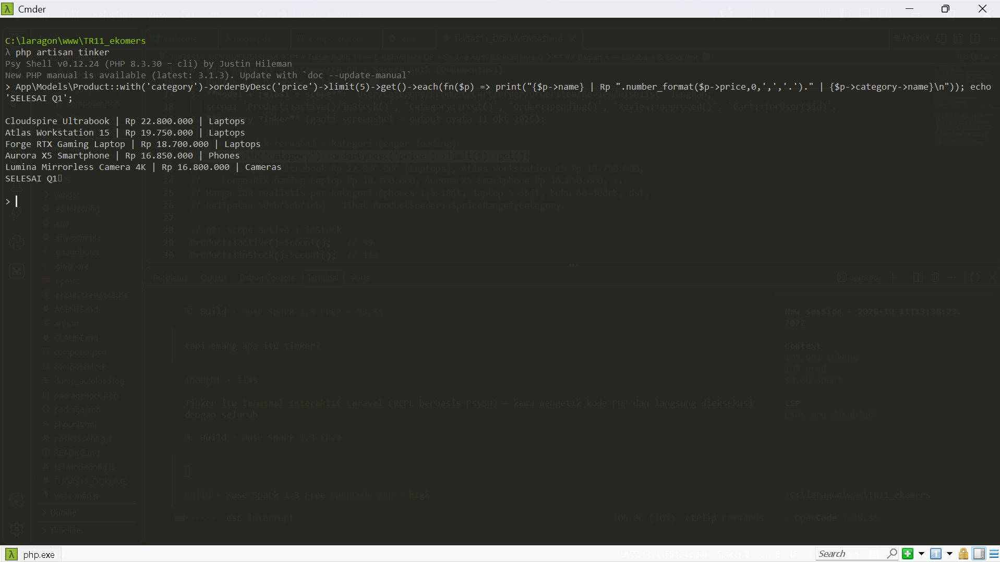</p>

**Q2 — scope active + inStock**

<p align="center">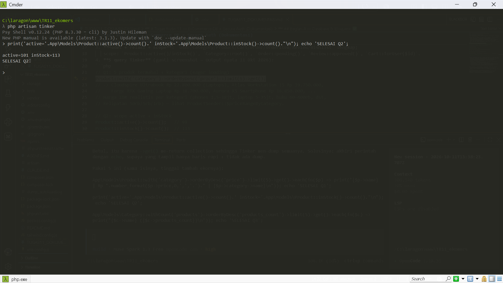</p>

**Q3 — kategori + jumlah produk**

<p align="center">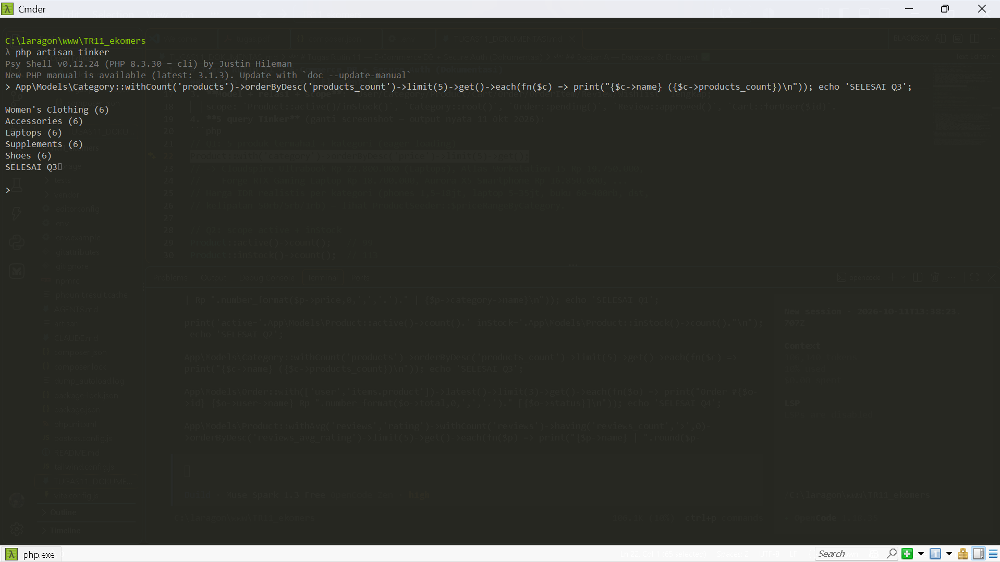</p>

**Q4 — order + user + item**

<p align="center">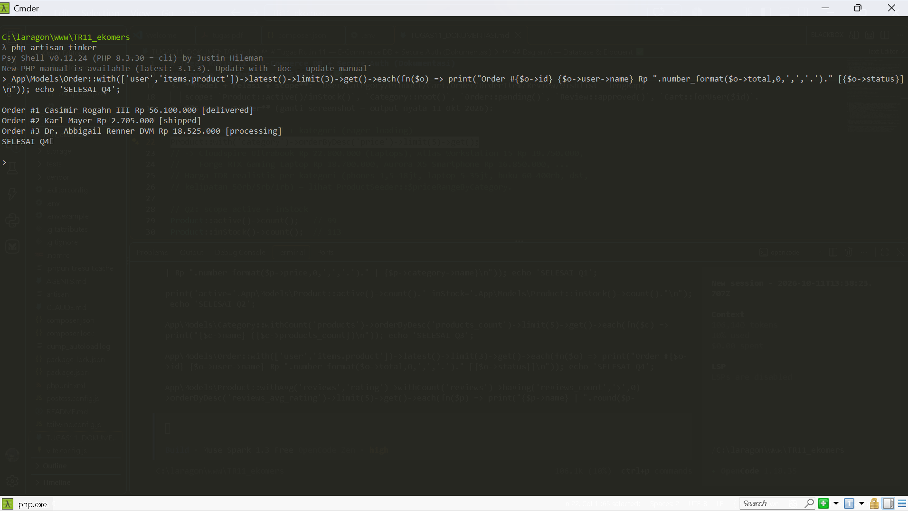</p>

**Q5 — rata-rata rating produk**

<p align="center">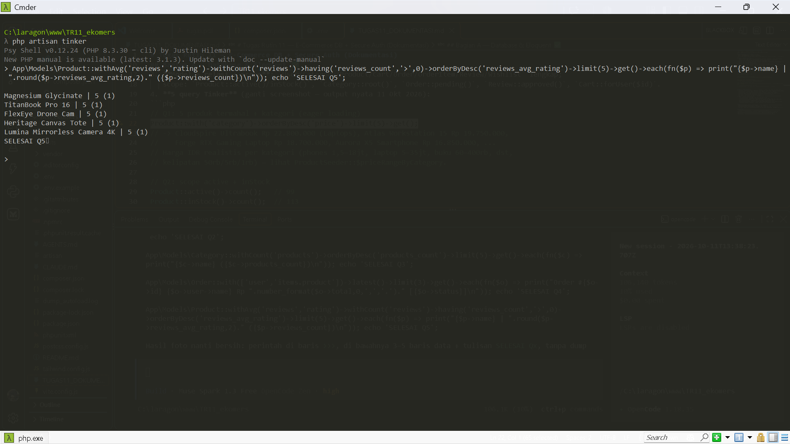</p>

### Dashboard per peran

| Admin (`/admin/dashboard`) | Editor (`/dashboard`) | User (`/dashboard`) |
|---|---|---|
| 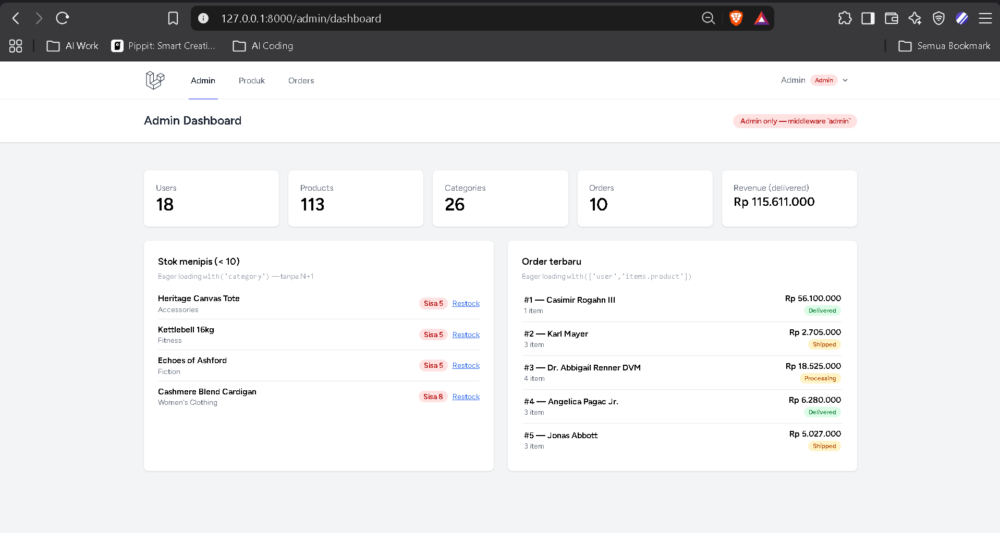 | 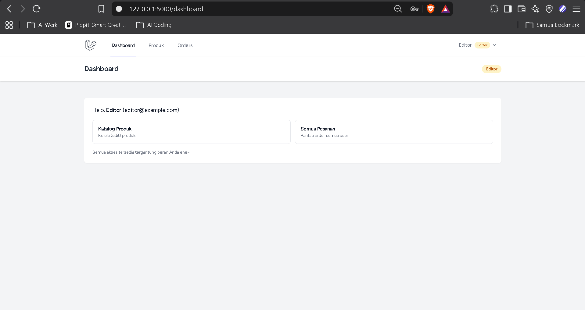 | 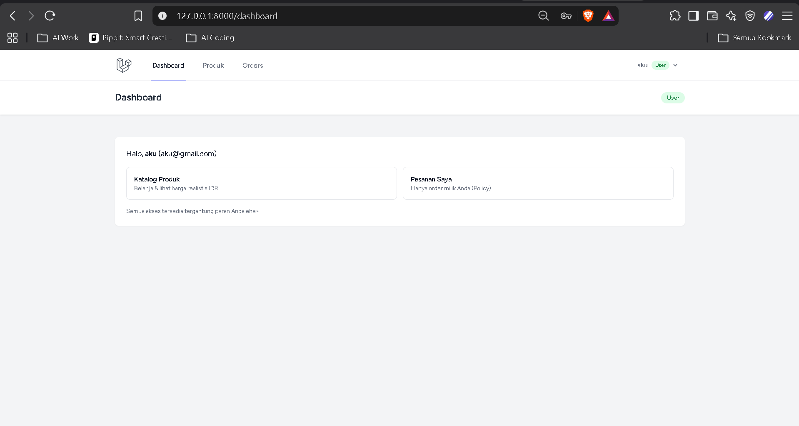 |

### Katalog per peran (`/products`)

| Admin — tombol Edit + Hapus | Editor — hanya Edit | User — tanpa tombol kelola |
|---|---|---|
| 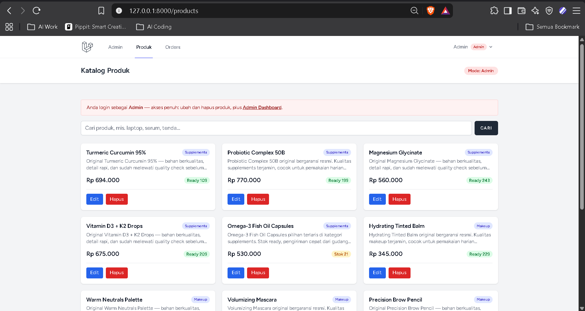 | 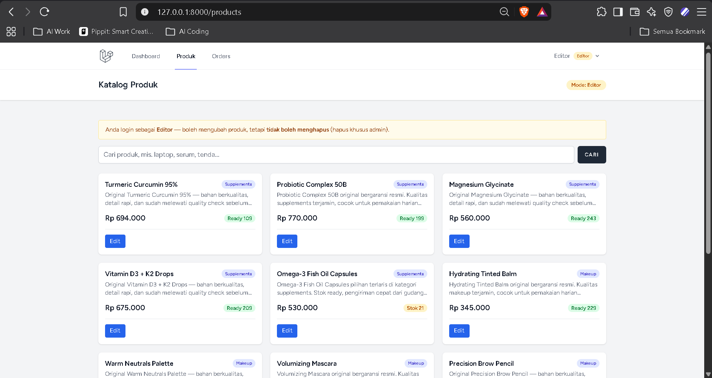 | 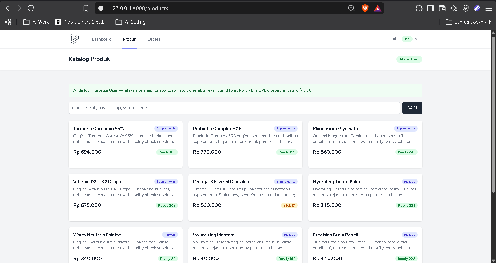 |

### Order per peran (`/orders`)

| Admin — semua pesanan | Editor — semua pesanan | User — hanya miliknya |
|---|---|---|
| 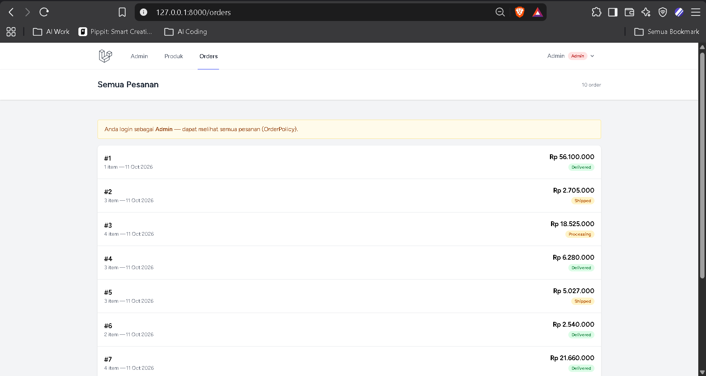 | 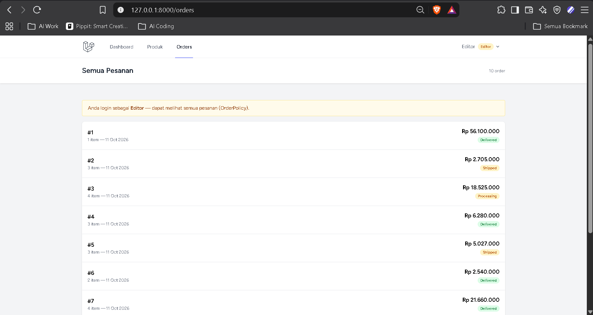 | 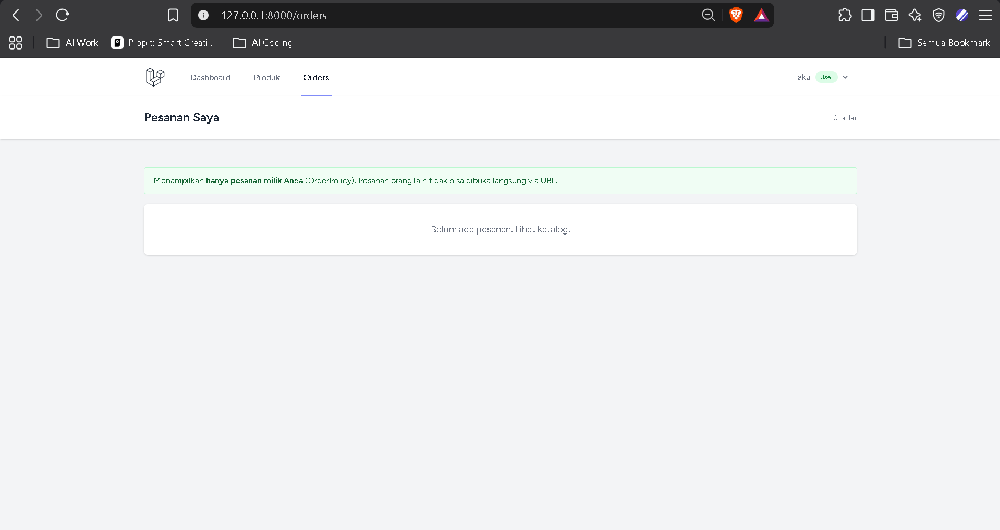 |

### Bukti penolakan akses (Bagian B No.8)

User membuka `/admin/dashboard` → **403**:

<p align="center">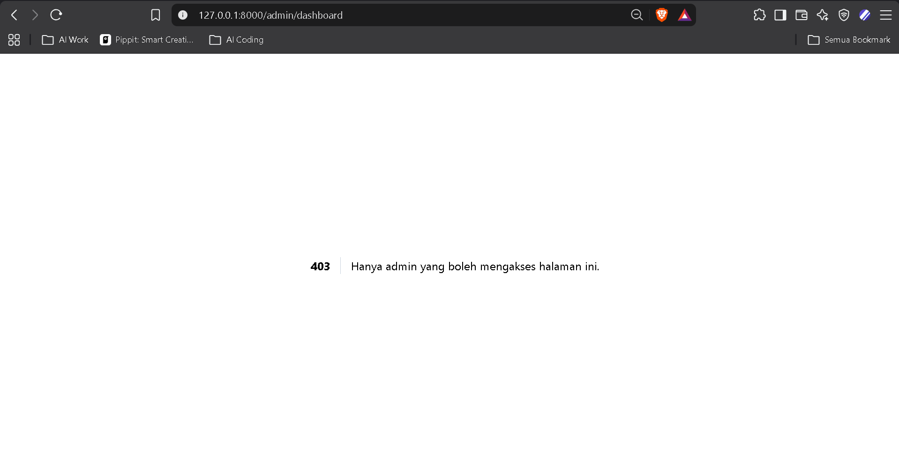</p>

## Struktur Proyek

```
database/migrations/   7 tabel e-commerce + fix users.role + reviews.is_approved
app/Models/            8 model + relasi + scope
database/{factories,seeders}/  data realistis IDR
app/Http/Middleware/   EnsureAdmin.php, EnsureRole.php
app/Policies/          ProductPolicy.php, OrderPolicy.php, PostPolicy.php
app/Providers/         AppServiceProvider.php (Gate admin, edit-products)
app/Http/Controllers/  ProductController, OrderController, Admin/DashboardController
routes/web.php         route terproteksi middleware + policy
resources/views/       admin/dashboard, products/*, orders/*, dashboard
dokumentasi/           15 screenshot bukti
```

## Tech Stack

<div align="center">

Laravel 13 · PHP 8.3 · MySQL · Breeze (Blade) · Tailwind CSS · PHPUnit

</div>
